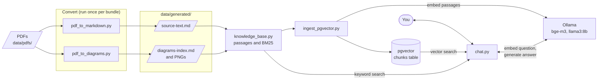
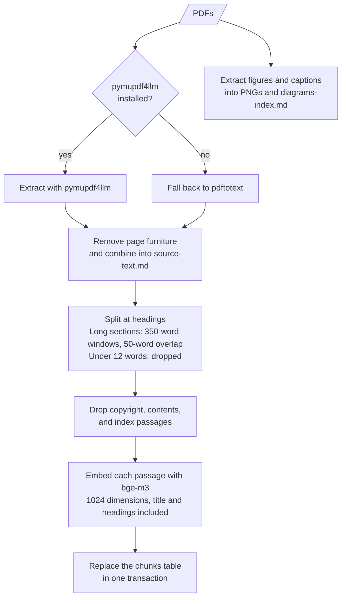
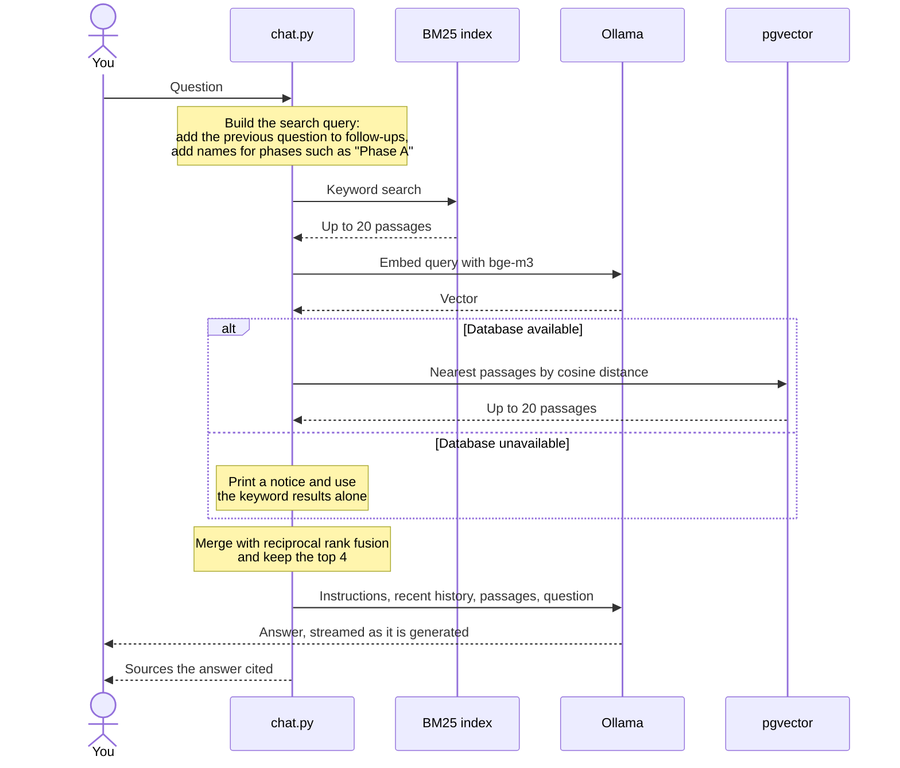

# Architecture

study-assist answers questions about PDF documents using only software on your own machine. It converts the PDFs to Markdown, indexes the text for keyword and vector search, and has a local model answer from the passages it finds.

Source documents and everything generated from them stay in `data/`, which git ignores.

## System overview

The Markdown is the data source for everything after conversion. `knowledge_base.py` never opens a PDF, so it runs on a checkout that only has the generated files.

`chat.py` doesn't use the figures yet, although `knowledge_base.py` indexes them.

## Data pipeline

All embeddings are computed before the table is touched, so a failed load leaves the existing data in place. The downside is that nothing is saved until embedding finishes, and a failed run has to start over.

The figures are indexed in memory for search by `knowledge_base.py`, and they aren't loaded into pgvector.

## How a question is answered

Two details affect the answers:

- **History:** the model sees the last three questions and answers, but not the passages behind them, because passage numbers restart with each question.
- **Citations:** only passages the answer cites as `[n]` are listed as sources. If the model cites nothing, the chat prints `Sources: none cited`.

## Modules

| File | Purpose | Needs |
|---|---|---|
| `study_assist/paths.py` | Default data locations | Nothing |
| `study_assist/pdf_to_markdown.py` | Converts PDFs to a single Markdown file | `pymupdf4llm` or `pdftotext` |
| `study_assist/pdf_to_diagrams.py` | Extracts figures and captions | `pymupdf` |
| `study_assist/knowledge_base.py` | Splits text into passages; BM25 search over passages and figures | Generated Markdown |
| `study_assist/ingest_pgvector.py` | Embeds passages and replaces the `chunks` table | Ollama and the database, except with `--dry-run` |
| `study_assist/chat.py` | Answers questions and cites sources | Ollama; the database is optional |

Supporting files:

| File | Purpose |
|---|---|
| `db/init/001_schema.sql` | Creates the `chunks` table and its HNSW index when the database is first created |
| `compose.yaml` | Runs pgvector on `127.0.0.1`, port 5433 by default |
| `ansible/setup.yml` | Automates setup on the local machine |

## Design decisions

### Local models only

Documents and questions never leave the machine, and there are no API costs. The cost is speed and answer quality, because a small model on a CPU is limited on both.

### Keyword and vector search together

Standards documents use precise terms, which suit BM25 and work with no database or models. Vector search should help when a question is worded differently from the text. Merging by rank avoids comparing two incompatible kinds of score.

### Tuned for CPU

These measurements come from one laptop with an Intel Core Ultra 5 225H and no dedicated GPU, using a prompt of about 560 tokens. Treat them as a guide, since other machines will differ.

| Model | Threads | Prompt (tokens/s) | Generation (tokens/s) |
|---|---|---|---|
| `mistral-nemo` | Ollama default | 7.6 | 2.3 |
| `mistral-nemo` | 4 | 15.3 | 4.2 |
| `mistral-nemo` | 8 | 19.1 | 6.6 |
| `mistral-nemo` | 12 | 22.1 | 4.9 |
| `llama3:8b` | 6 | 27.3 | 7.1 |

This led to the chat's current settings:

- **Threads:** 8, or the CPU's core count if that is lower. This was the fastest generation speed measured on `mistral-nemo`. `llama3:8b` was only benchmarked at 6 threads and at the default.
- **Passages:** 4 per question, because every passage adds to the wait before an answer starts.
- **Model:** `llama3:8b`, chosen mainly for speed. It has not been compared with other models for accuracy across a set of questions.
- **Keep-alive:** the model stays loaded for 30 minutes, which avoids a reload of about 11 seconds.

### What stays private

- `.gitignore` excludes `data/`, PDFs, `.env`, and Markdown outside `README.md` and `docs/`.
- The database port is bound to `127.0.0.1`, so it isn't reachable from other machines.
- These docs describe the code and contain no source material.

## Current limitations

- **Vector search is untested:** it has never run against a live database. All chat testing so far has used the BM25 fallback.
- **Answers can be wrong:** in testing, an answer listed an output from another phase as a Phase A output, and another left Requirements Management out of the ADM phases. Check answers against the cited sources.
- **Some section labels look wrong:** at least one citation shows a heading trail from a different section, such as `7. Phase C ... / 8.4. Outputs`. The likely cause is heading parsing in `knowledge_base.py`, but that hasn't been confirmed.
- **Citations are approximate:** `chunks` stores the document and section but no page number or passage ID.
- **No automated tests or CI:** changes are checked by running the tools by hand.
- **Figures and study decks aren't used:** the chat doesn't use figures, and nothing reads `data/decks/`.

See the [roadmap](roadmap.md) for ways to address these.
