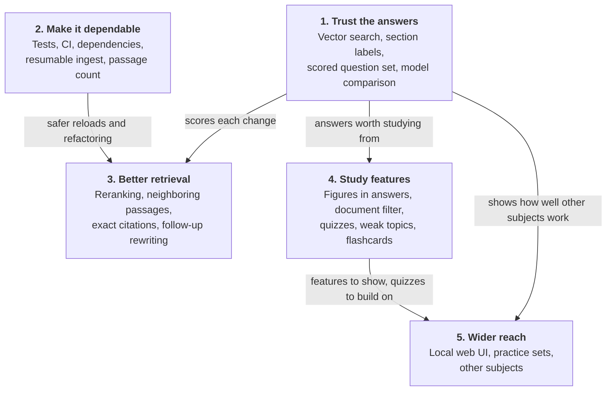

# Roadmap

These are proposals for where to take the project, not commitments. Sizes are rough: **S** is under a day, **M** is a few days, and **L** is a week or more.

**Start with stage 1.** The chat's answers aren't reliable enough yet (see [current limitations](architecture.md#current-limitations)), and study features built on unreliable answers would teach the wrong material. A scored question set also shows whether each later change actually helps.

## How the work connects

An arrow means the first stage should mostly come before the second. Stage 2 can run alongside stage 1, and stages 3 and 4 can run in either order. Within stage 1, finish the vector search and section labels before writing the question set, so that it measures the fixed system.

## Stage 1: Trust the answers

| Option | Why it matters | Size | Files |
|---|---|---|---|
| Run vector search end to end | It has never run against a live database, so its benefit is unknown. Start the database, load all passages, and compare answers with the BM25-only results. | S (plus up to 2 hours of loading) | `chat.py`, `ingest_pgvector.py` |
| Fix section labels | Wrong labels make sources harder to check. Find out why some heading trails mix sections, then correct them and reload. | S–M | `knowledge_base.py`, possibly `pdf_to_markdown.py` |
| Scored question set | A set of questions with expected sources and key facts measures retrieval and answers separately, and turns "seems better" into a number. Keep it free of quoted source text, or store it under `data/`. | M | New `study_assist/evaluate.py` |
| Compare models | `llama3:8b` was chosen mainly for speed. Use the question set to find the best accuracy for an acceptable wait, including `mistral-nemo` and `qwen3:8b`. | S, once the set exists | `chat.py` |

## Stage 2: Make it dependable

| Option | Why it matters | Size | Files |
|---|---|---|---|
| Tests | Parsing, merging, and query expansion can be tested without a model or database, using small made-up documents. | M | New `tests/` |
| CI | Runs those tests on each push. It can't use the source documents, so tests must bring their own data. | S | New `.github/workflows/` |
| Complete the dependencies | `requirements.txt` omits `pymupdf` and `pymupdf4llm`, which the README installs separately, and `httpx`, which `chat.py` imports directly. | S | `requirements.txt`, `README.md` |
| Resumable ingest | A failed load currently starts over after as long as 2 hours. Saving embeddings as they finish would let it continue, and would allow progress output under Ansible. | M | `ingest_pgvector.py`, `ansible/setup.yml` |
| Show loaded passages at startup | The setup playbook loads only 50 passages by default, and the chat gives no sign of this. Printing the count, and warning when it's low, makes a partial load obvious. | S | `chat.py` |

## Stage 3: Better retrieval

Measure each of these with the question set, and keep only what improves the score enough to justify any added wait.

| Option | Why it matters | Size | Files |
|---|---|---|---|
| Reranking | A second, more careful pass over the 40 or so candidates could put better passages in the top 4, but adds time on a CPU. | M | `chat.py` |
| Neighboring passages | Answers can get cut off where a passage ends. `KnowledgeBase.around()` already returns adjacent passages, though each one adds to the wait. | S–M | `chat.py` |
| Exact citations | Storing passage IDs and page numbers in `chunks` would let citations name a page. Passages don't track page numbers yet, so the converter output would need to carry them. | M–L | `db/init/001_schema.sql`, `ingest_pgvector.py`, `knowledge_base.py`, `pdf_to_markdown.py`, `chat.py` |
| Rewrite follow-up questions | A regex decides what counts as a follow-up today, and it's easily fooled. Having the model rewrite the question would be more accurate, but adds a model call. | S–M | `chat.py` |

## Stage 4: Study features

| Option | Why it matters | Size | Files |
|---|---|---|---|
| Figures in answers | The diagrams are already extracted and searchable through `search_diagrams()`, and TOGAF relies heavily on them. The terminal could list matching image paths, and a web UI could show them. | S | `chat.py` |
| Filter by document | `search_passages()` already accepts a document filter. Exposing it would let you restrict a question to one guide, though the vector search needs the same filter. | S | `chat.py` |
| Quiz mode | Answering questions tests recall better than reading answers does. Generate questions from passages, then grade replies against those same passages. | M | New `study_assist/quiz.py` |
| Weak topic tracking | Save quiz results by section, then focus on the topics you miss most. | M | `quiz.py`, new database table |
| Flashcard export | Export generated questions to a format such as Anki's, for review away from the machine. Exports contain source-derived text, so they belong in `data/`. | S–M | `quiz.py` |

## Stage 5: Wider reach

| Option | Why it matters | Size | Files |
|---|---|---|---|
| Local web UI | Easier to use than a terminal, and it can show figures inline. It should bind to `127.0.0.1` like the database, and it would need `chat.py`'s question logic separated from its printing. | M–L | `chat.py`, new `study_assist/web.py` |
| Exam-style practice sets | Timed question sets with scores build on quiz mode. Generated questions should be labeled as unofficial, since they aren't real exam questions. | M | `quiz.py` |
| Other subjects | The system prompt and phase names are the main TOGAF-specific parts of `chat.py`. Making them configurable would let the tool work with any PDF collection, and the question set would show how well it does. | M | `chat.py` |

## Suggested first steps

1. Start the database and load all passages.
2. Re-run the test questions with vector search on, and record the differences.
3. Fix the section labels and reload.
4. Write 20–30 questions as the first scored set, then use it to compare models.
